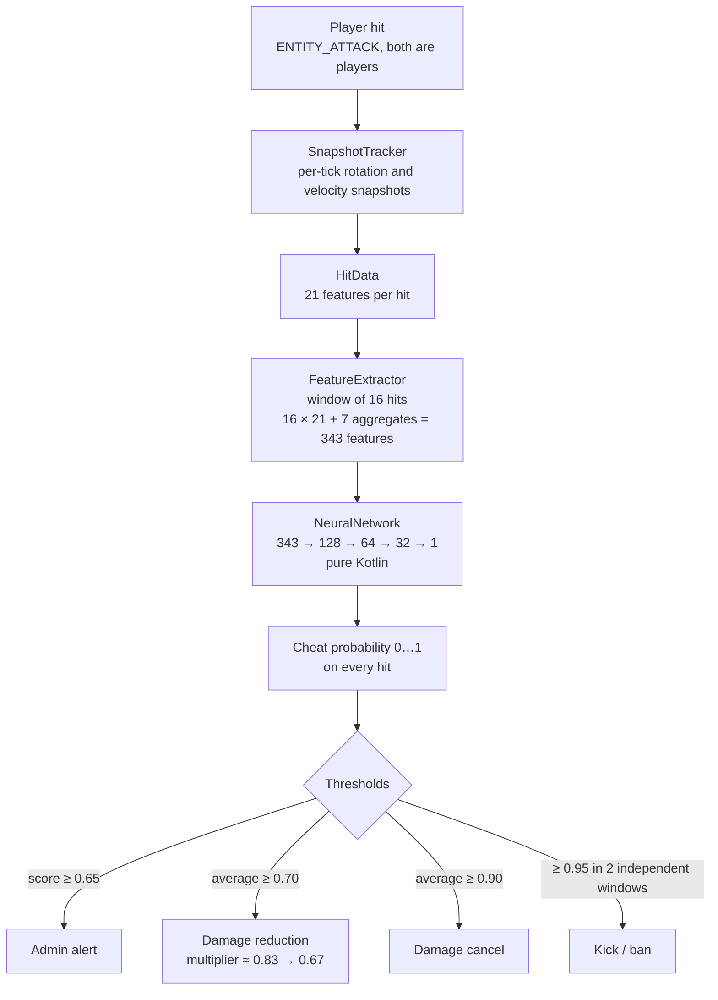

# DaynAC

[](https://github.com/6lGRUSHAl6/DaynAC/actions/workflows/release.yml)
[](https://github.com/6lGRUSHAl6/DaynAC/releases)
[](LICENSE)


* [Русский](README.md)

> [!CAUTION]
> **Early alpha.** Behavior, settings and file formats may change from release to release - check the release notes and run `/daynac eval` before touching thresholds.

**A neural-network anti-cheat for Minecraft PvP servers.** Detects external aim assistance (AimBot / KillAura) through behavioral hit patterns - no speed-hack checks, packet sniffers, or other conventional techniques. The model is trained on datasets that you collect yourself on your server.

The target use case is **1.9+ no-cooldown PvP**, where legitimately high CPS is not evidence of cheating: the distinction between legitimate play and cheating is based not on click speed, but on aiming geometry and timing.

## Contents

- [Highlights](#highlights)
- [How it works](#how-it-works)
- [Installation](#installation)
- [Quick start](#quick-start)
- [Commands](#commands)
- [Permissions](#permissions)
- [Collecting a dataset](#collecting-a-dataset)
- [Training and evaluating the model](#training-and-evaluating-the-model)
- [How decisions are made](#how-decisions-are-made)
- [Configuration](#configuration)
- [Plugin files](#plugin-files)
- [Architecture](#architecture)
- [Known limitations](#known-limitations)
- [Development](#development)
- [License](#license)

---

## Highlights

- **A model tailored to your server.** No shipped signatures: the network learns from data you recorded yourself - both the legit and the cheat sessions are played by your people.
- **Behavior, not clicks.** 343 features per window of 16 hits: aiming geometry, rotation entropy, timing predictability. Details in [How it works](#how-it-works).
- **Zero ML dependencies.** The MLP 343→128→64→32→1 is written in pure Kotlin: neither Python nor PyTorch is needed on the server.
- **The main tick stays free.** Inference runs in separate daemon threads; model weights are an immutable snapshot behind an `AtomicReference`, so retraining on a live server never blocks detection.
- **Everything stays local.** The dataset, model and config live in `plugins/DaynAC/`; there is no telemetry; player UUIDs never end up in CSV files - SHA-256 pseudonyms with a salt are used instead.
- **Honest metrics.** Wilson confidence intervals in `/daynac eval`, session-based splitting against data leakage, and explicit warnings while there is not enough data yet.

### Comparison of approaches

| | **DaynAC** | Classic CPS checks | Packet anticheats |
|---|---|---|---|
| What it analyzes | the geometry and timing of every hit | click frequency per window | packet anomalies against client signatures |
| Required input | your dataset (hundreds of vectors per class) | nothing | an up-to-date protocol parser for every client release |
| Blind spot | deaf until the dataset exists | in 1.9+ PvP legitimate players click just as fast | every new client version is a new arms race |

---

## How it works



**Features for each hit:** aim angle, distance, interval between hits and its variation, rotation entropy (abs/signed, yaw/pitch), jitter, XZ velocity, rotation smoothness, snap factor (sudden final adjustment of the aim), micro-corrections, jerk, rotation linearity, reach.

**Window aggregates:** mean angle, coefficients of variation, angle-distribution entropy, lag-1 autocorrelations (mechanical predictability of timing and aim), R² of the angle's linear trend (monotonic final adjustment of the aim).

CPS is deliberately not used as a feature: in no-cooldown PvP, legitimate players click fast and steadily. Mechanical regularity is captured by the autocorrelation of hit intervals, not by their absolute speed.

> [!NOTE]
> Only **landed** `ENTITY_ATTACK` hits between players are recorded. Hits cancelled by other plugins and sword sweep attacks never enter the history.

---

## Installation

### Requirements

| Requirement | Value |
|---|---|
| Server | **Paper 1.21.11 or newer** (the same jar; tested on 1.21.11 and up to 26.3) |
| Java | **21+** for 1.21.11 and **25+** for Paper 26.1+ (a server requirement; the plugin is built for Java 21 and runs on both) |

### Prebuilt JAR

1. Download `DaynAC-<version>-all.jar` from [Releases](https://github.com/6lGRUSHAl6/DaynAC/releases) (every push to `main` publishes a new build), or build it yourself (see below).
2. Copy the jar into the server's `plugins/` folder.
3. Start the server. The plugin creates `plugins/DaynAC/` with `config.yml`.
4. Adjust the thresholds for your server and restart.
5. Grant permissions to your staff (see [Permissions](#permissions)): ops only need `daynac.admin`, everyone else gets what they need from the list.

> [!IMPORTANT]
> **Detection stays disabled until a model has been trained.** Until you collect a dataset and run `/daynac train`, the plugin works only as a data collector.

### Building from source

You need Gradle **9.7** (the version from `gradle/wrapper/gradle-wrapper.properties`; there are no wrapper scripts in the repository - CI installs Gradle itself):

```bash
gradle build               # resulting JAR: build/libs/DaynAC-<version>-all.jar
```

To launch a local test server directly from the project:

```bash
gradle runServer                       # Paper 1.21.11 with the plugin (2 GB RAM)
gradle runServer -PmcVersion=26.1.2    # same, on another Minecraft version
```

---

## Quick start

1. Record **several legit sessions** and **several cheat sessions** (see [Collecting a dataset](#collecting-a-dataset)).
2. Run `/daynac train`.
3. Run `/daynac eval` and look at the false-positive rate on your data.
4. Start with alerts only (see the note on damage modification in [Known limitations](#known-limitations)) and watch `/daynac allinfo`.
5. Enable kick first, and ban only once you trust the model.

---

## Commands

Each command requires its own permission (see [Permissions](#permissions)); `daynac.admin` (ops by default) has all of them.

| Command | What it does | Permission |
|---|---|---|
| `/daynac record <player> <legit\|cheat\|off>` | Record dataset samples for a player | `daynac.record` |
| `/daynac train` | Train the model on the collected dataset | `daynac.train` |
| `/daynac eval` | Test-set metrics across a range of thresholds | `daynac.train` |
| `/daynac info` | Dataset, sessions, model state, thresholds | `daynac.view` |
| `/daynac ver [player]` | Without a name: plugin status; with a name: the player's scores and hit count in the current window | `daynac.view` |
| `/daynac allinfo` | Player-monitoring GUI (teleporting from it needs `daynac.spectate`) | `daynac.view` |
| `/daynac reset` | Return from observation to where it started (location and game mode) | `daynac.spectate` |
| `/daynac debug` | Toggle per-hit logging to players with `daynac.alerts` | `daynac.config` |
| `/daynac clearflags <player>` | Manually reset a player's flags and current window | `daynac.config` |
| `/daynac exempt <player> [time\|off]` | Grant a temporary exemption from detection (`30s`, `5m`, `2h`, `1d`); without time - permanent; `off` - remove | `daynac.exempt.manage` |
| `/daynac reload` | Reload `config.yml` (threshold changes need a restart) | `daynac.config` |

---

## Permissions

Permissions are checked per subcommand, so access can be granted in parts (for example via LuckPerms). `daynac.admin` (ops by default) includes all permissions below **except** `daynac.exempt`.

| Permission | Grants |
|---|---|
| `daynac.view` | `/daynac ver`, `info`, `allinfo` (read-only) |
| `daynac.alerts` | suspicious-hit alerts and the per-hit log (`/daynac debug`) in chat |
| `daynac.spectate` | teleport to a player from `/daynac allinfo` in spectator mode and return via `/daynac reset` |
| `daynac.record` | `/daynac record` |
| `daynac.train` | `/daynac train`, `eval` |
| `daynac.config` | `/daynac reload`, `debug`, `clearflags` |
| `daynac.exempt.manage` | `/daynac exempt` (grant and revoke temporary exemptions) |
| `daynac.exempt` | permanent exemption from detection; **not** part of `daynac.admin` |

LuckPerms example:

```
/lp group moderator permission set daynac.view true
/lp group moderator permission set daynac.alerts true
/lp group senior-mod permission set daynac.spectate true
/lp group dataset-team permission set daynac.record true
```

<details>
<summary><b>Things to know about permissions</b></summary>

- An empty or unknown subcommand requires `daynac.view`, so outsiders cannot list the commands.
- **Grant `daynac.record` only to the people who collect the dataset.** The `legit`/`cheat` label is set by hand by whoever records: a mistaken or deliberately wrong label will poison the model on the next `/daynac train`. While a player is being recorded, detection does not check them.
- `daynac.exempt` is deliberately separate from `daynac.admin`: otherwise a stolen admin account would be immune to the anti-cheat, and admins could not test the plugin on themselves. Grant it explicitly, and only to people you trust.
- `daynac.exempt.manage` is part of `daynac.admin`: an operator can grant temporary exemptions to other players. By itself it does not provide immunity - the exemption must be activated via `/daynac exempt`.
- Temporary exemptions are stored in `exemptions.yml` and expire automatically; permanent immunity (`daynac.exempt`) does not expire.
- `daynac.spectate` is re-checked on every click in the GUI, and `daynac.view` while it is open: a revoked permission takes effect immediately.

</details>

---

## Collecting a dataset

1. Ask a trusted player (or connect a second account) to take part in a PvP duel.
2. Enable recording:

   ```
   /daynac record <player> legit    # player plays legitimately
   /daynac record <player> cheat    # player uses cheats
   /daynac record <player> off      # stop recording
   ```

3. A feature vector is recorded every 16 hits (non-overlapping windows) in `plugins/DaynAC/legit_vectors.csv` and `cheat_vectors.csv`. Players in recording mode are not checked by detection: they are exempt while data is being collected (permanent exemption is granted by `daynac.exempt`).

Two metadata columns are appended to each vector:

- `session_id`: one recording, from `record <player> legit|cheat` until `off`;
- `player_hash`: a pseudonym for the player, the SHA-256 of the UUID with the salt from `dataset.salt`. The UUID itself is never written to the CSV.

These columns are not used for training; they are used to split the dataset. Files in the old format are upgraded automatically, with a `*.bak` backup created first; old rows remain ungrouped. Do not lose or publish `dataset.salt`: without it, hashes for new recordings will not match the old ones.

> [!TIP]
> **Data quality is what it all comes down to:**
>
> - you need **both classes** in comparable numbers (hundreds of vectors per class);
> - variety matters more than quantity: different distances, movement, targets, cheat settings;
> - record **at least 3 separate sessions per class**, preferably with different players; otherwise a proper group-based split is impossible;
> - include "hard" legit players (high DPI, low sensitivity, fast aim): they are where the model most often makes mistakes.

**Feature versioning.** If you change what any feature means, bump `FeatureExtractor.FEATURE_VERSION`. On startup the plugin compares it with `dataset.featver`: incompatible datasets are renamed to `<name>.featv<N>.bak` (nothing is deleted), and an incompatible model is renamed to `model.dat.old`.

---

## Training and evaluating the model

### `/daynac train`

- Splits the dataset 60/20/20 into train/validation/test (stratified by class) and normalizes features using the training portion only.
- If there are ≥ 3 groups per class, it splits by **whole groups** (`training.split-by: session` or `player`), so windows from the same player never end up in both training and testing. With fewer groups, the split is random by window, and the plugin warns that the metrics are likely inflated.
- Trains with early stopping on validation loss and restores the best weights. The test set is not used for training or epoch selection.
- At least 5 vectors per class are required (in practice, hundreds are recommended).
- Progress is shown in real time: a live progress bar in the action bar (for the player) and progress updates in chat every 10% of the epochs.
- On completion: a report with train/validation/test metrics and the train/validation gap (overfitting); the model is saved to `model.dat` and detection is enabled automatically.

A large gap between train and validation accuracy means the data is insufficient or too uniform.

### `/daynac eval`

Shows precision, recall, F1 and FPR on the test set for a range of thresholds, with 95% Wilson confidence intervals. A threshold is recommended only if the **upper bound** of the FPR is ≤ 1%. Even with zero errors, this requires ≥ 381 legit windows in the test set (roughly 1,900 legit vectors in the whole dataset). Until you have that much data, the plugin will tell you plainly that a low FPR is not statistically confirmed.

> [!IMPORTANT]
> `eval` only works in the same server run in which training happened: the test set is not stored in `model.dat`.

---

## How decisions are made

A cheat probability is computed on **every** hit from the last 16 hits, so neighboring scores are almost identical (windows overlap by 15 of 16 hits).

| What | Rule |
|---|---|
| Alert (players with `daynac.alerts`) | the current hit's score ≥ `flag-threshold` (0.65) |
| Damage reduction | the average of the last `max-recent-predictions` (10) predictions ≥ `reduce-threshold` (0.70): the multiplier falls smoothly from ≈0.83 to ≈0.67 |
| Damage cancel | the same average ≥ `cancel-threshold` (0.90) |
| Kick / ban | score ≥ `punish-threshold` (0.95) in `punish-confirm-windows` (2) **independent** windows in a row |

False-positive safeguards:

- the damage multiplier is calculated from **previous** predictions, so a player with no history always deals full damage on the first hit;
- a window counts as independent only if it arrives at least 16 hits after the previously counted one (no hits in common). By default, punishment therefore needs roughly 32 consecutive hits at ≥ 0.95. An independent window gets up to 8 extra hits (half a window) to reach the threshold; if it is still below, the streak is broken;
- after a punishment the streak is consumed: a repeat requires a fresh full streak;
- inference runs asynchronously, so the server's main tick is never blocked.

**Inactivity reset.** If a player has not hit anyone for longer than `inactivity-reset-seconds`, their flags are cleared: active predictions and the hit window are discarded, and the next 16 hits fill a new window. So that a cheater does not get a clean slate after 30 seconds of silence, the plugin remembers their average score (if it was ≥ `reduce-threshold`) for another `carry-over-seconds`: the score decays linearly to zero, and until a new window is filled, damage is calculated from it.

The log is not cleared by the reset: the player stays in `/daynac allinfo` with "Recent hits" and their all-time maximum, and the card shows progress of the new window (`Hits: n/16`) and the verdict "Flags cleared after inactivity". The reset affects only online players; flags of players who have left are kept until TTL cleanup (1 hour), giving admins time to review them.

**Manual reset.** The command `/daynac clearflags <player>` clears flags and resets the window immediately, without waiting for inactivity. Unlike the inactivity reset, the manual reset **does not** preserve the carry-over score: damage goes back to full from the first hit. The log and hit counter are also not cleared.

### Example chat alert

```
[DaynAC] Steve: unusual hit 0.871 > threshold 0.65 - recent hits: 0.31 0.44 0.61 0.87 (average: 0.54)
```

---

## Configuration

`plugins/DaynAC/config.yml`:

```yaml
hit-logging: false           # log every hit

detection:
  flag-threshold: 0.65       # threshold for admin alerts
  reduce-threshold: 0.70     # start reducing damage
  cancel-threshold: 0.90     # cancel damage completely
  punish-threshold: 0.95     # automatic kick/ban threshold
  punish-confirm-windows: 2  # consecutive independent windows (16 hits each) that must be >= punish-threshold
  punish-enabled: true       # false = no kick/ban (alerts and damage reduction keep working)
  punish-action: kick        # none | kick | ban
  ban-with-ip: false         # ban: also ban by IP (NAT networks may affect innocent players)
  punish-reason: "KillAura (detected by DaynAC neural network)"
  max-recent-predictions: 10 # averaging window for damage and punishment
  inactivity-reset-seconds: 30  # after this long without hits, flags are cleared (0 = disabled)
  carry-over-seconds: 600    # how long to remember the score after an inactivity reset (0 = don't)

training:
  split-by: session          # session | player: what to split train/val/test by
```

> [!IMPORTANT]
> Threshold ordering is validated at startup: `flag ≤ reduce < cancel ≤ punish`. Thresholds are read once when the plugin starts, so after `/daynac reload` a restart is needed for threshold changes to take effect.

---

## Plugin files

Everything is stored locally in `plugins/DaynAC/`. There is no telemetry.

| File | Purpose |
|---|---|
| `config.yml` | settings |
| `legit_vectors.csv`, `cheat_vectors.csv` | the dataset (vectors + `session_id`, `player_hash`) |
| `dataset.salt` | salt for `player_hash`; do not lose or publish it |
| `dataset.featver` | the feature version the dataset was collected with |
| `model.dat` | the trained model |
| `exemptions.yml` | temporary exemptions from detection (UUID + expiration time) |
| `*.bak`, `model.dat.old` | backups made on a format or feature-version change |

---

## Architecture

<details>
<summary><b>Source layout and key engineering decisions</b></summary>

```text
src/main/kotlin/zov/grusha/daynAC/
├── DaynAC.kt              # entry point: events, commands, dataset recording
├── compat/
│   └── Compat.kt          # Paper version compatibility (action bar)
├── permissions/
│   └── Permissions.kt     # plugin permissions and the subcommand → permission table
├── exemptions/
│   └── ExemptionManager.kt# temporary player exemptions from detection
├── tracking/
│   ├── CombatMath.kt      # geometry: aim angle, distance, reach
│   ├── HitData.kt         # feature snapshot for a single hit
│   ├── HitTracker.kt      # sliding window of hit history
│   ├── PlayerSnapshot.kt  # rotation/velocity deltas per tick
│   └── SnapshotTracker.kt # per-tick player snapshots, rolling metrics
├── ml/
│   ├── FeatureExtractor.kt# hit window → 343-feature vector
│   ├── DatasetManager.kt  # CSV datasets, sessions, feature version
│   ├── NeuralNetwork.kt   # MLP + backprop, lock-free inference
│   └── Stats.kt           # confidence intervals for /daynac eval
├── detection/
│   └── DetectionEngine.kt # asynchronous inference, thresholds, punishments
└── gui/
    └── AllInfoGUI.kt      # player monitoring GUI
```

Key engineering decisions:

- **Dependency-free neural network.** MLP 343→128→64→32→1 in pure Kotlin (BCE + SGD + He initialization + L2 + gradient clipping). Neither PyTorch nor Python is needed.
- **Lock-free inference.** Weights live in an immutable snapshot behind an `AtomicReference`: `predict()` takes no locks, and retraining on a live server does not block detection.
- **Atomic model publishing.** `train` and `loadFrom` are serialized with a mutex, and the model file is written via tmp+rename, so a server crash cannot corrupt `model.dat`.
- **Data-leakage protection.** Non-overlapping windows when recording, session/player-based splitting, class stratification, and normalization from the training portion only.
- **Feature versioning.** Old datasets and models are never silently mixed with new ones.

</details>

---

## Known limitations

- Only **landed** hits are analyzed. Misses and arm swings are not considered.
- **Ping is not accounted for.** The aim angle is computed against the victim's current server-side position, without latency compensation.
- No pretrained model is shipped: the model is only as good as your dataset.
- Output probabilities are not calibrated: 0.70 does not necessarily mean "70% cheater". Rely on `/daynac eval`, not on absolute numbers.
- `punish-enabled: false` disables only kick/ban. Damage reduction and cancellation stay active; there is no separate switch yet.

---

## Development

```bash
gradle test          # unit tests (detection, tracking, ML module, permissions; ~200 tests)
gradle build         # tests + shadowJar
```

`PermissionsTest` checks `Permissions.kt` against `plugin.yml`: when adding a permission, update both files.

Found a bug, a false positive, or have an idea - open an [Issue](https://github.com/6lGRUSHAl6/DaynAC/issues).

Releases are published by GitHub Actions: every push to `main` builds a jar and creates a release versioned `<version from gradle.properties>.<build number>`. To push without a release, start the commit message with `[skip release]`.

---

## License

MIT
