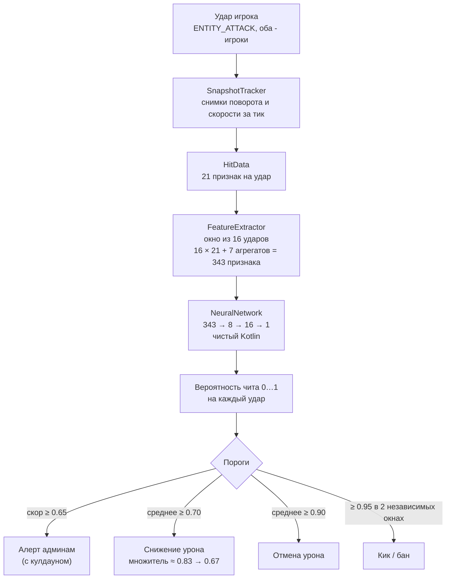

# DaynAC

[](https://github.com/6lGRUSHAl6/DaynAC/actions/workflows/release.yml)
[](https://github.com/6lGRUSHAl6/DaynAC/releases)
[](LICENSE)


* [English](README.en.md)

> [!CAUTION]
> **Ранняя alpha.** Поведение, настройки и формат файлов могут меняться от версии к версии - сверяйтесь с релизами и прогоняйте `/daynac eval` перед изменением порогов.

**Нейросетевой античит для Minecraft PvP-серверов.** Детектирует сторонние помощники наведения (AimBot / KillAura) по поведенческим паттернам ударов - без спидхак-чеков, пакетных сниферов и прочей классики. Модель обучается на датасетах, которые вы собираете сами на своём сервере.

Целевой сценарий - **1.9+ PvP**, где легитимно высокий CPS не является признаком чита: разделение легит/чит строится не на скорости кликов, а на геометрии и тайминге прицеливания.

## Содержание

- [Особенности](#особенности)
- [Как это работает](#как-это-работает)
- [Установка](#установка)
- [Быстрый старт](#быстрый-старт)
- [Команды](#команды)
- [Права доступа](#права-доступа)
- [Сбор датасета](#сбор-датасета)
- [Обучение и оценка модели](#обучение-и-оценка-модели)
- [Как принимаются решения](#как-принимаются-решения)
- [Наблюдение за игроками (GUI)](#наблюдение-за-игроками-gui)
- [Конфигурация](#конфигурация)
- [Файлы плагина](#файлы-плагина)
- [Архитектура](#архитектура)
- [Известные ограничения](#известные-ограничения)
- [Разработка](#разработка)
- [Лицензия](#лицензия)

---

## Особенности

- **Модель под ваш сервер.** Никаких готовых сигнатур: сетка учится на данных, которые вы записали у себя - легит и читы играют ваши же люди.
- **Поведение, а не клики.** 343 признака на окно из 16 ударов: геометрия наведения, энтропия поворотов, предсказуемость тайминга. Подробности - в [Как это работает](#как-это-работает).
- **Ноль ML-зависимостей.** Компактный MLP 343→64→32→16 написан на чистом Kotlin: ни Python, ни PyTorch на сервере не нужны.
- **Главный тик свободен.** Inference работает в отдельных daemon-потоках; веса модели - immutable-снапшот за `AtomicReference`, переобучение на живом сервере не блокирует детекцию.
- **Всё локально.** Датасет, модель и конфиг живут в `plugins/DaynAC/`, телеметрии нет; UUID игроков в CSV не попадают - вместо них SHA-256 с солью.
- **Честные метрики.** Доверительные интервалы Уилсона в `/daynac eval`, разбиение по сессиям против утечки данных, явные предупреждения, когда данных ещё мало.
- **Осторожное наказание.** Кик/бан только после нескольких независимых окон подряд, плавное снижение урона до этого, сброс флагов после простоя с «памятью» о подозрительном скоре.
- **Удобно админам.** Оповещения с кулдауном и агрегацией, настраиваемый текст экрана кика/бана, GUI наблюдения с телепортом, временные исключения для стримеров и тестеров.

### Сравнение подходов

| | **DaynAC** | Классические CPS-чеки | Пакетные античиты |
|---|---|---|---|
| Что анализирует | геометрию и тайминг каждого удара | частоту кликов за окно | аномалии пакетов относительно сигнатур клиентов |
| Что нужно на входе | ваш датасет (сотни векторов на класс) | ничего | актуальный разбор протокола под каждый релиз клиентов |
| Слепое пятно | глух, пока нет датасета | в 1.9+ PvP легит-игроки кликают так же быстро | каждая новая версия клиента - новая гонка |

---

## Как это работает



**Признаки на каждый удар:** угол прицеливания, дистанция, интервал между ударами и его вариация, энтропия поворотов (abs/signed, yaw/pitch), джиттер, скорость по XZ, плавность вращения, snap-фактор (резкое дожатие прицела), микрокорректировки, рывок (jerk), прямолинейность поворота, reach.

**Агрегаты по окну:** средний угол, коэффициенты вариации, энтропия распределения углов, автокорреляции lag-1 (механическая предсказуемость тайминга и прицела), R² линейного тренда угла (монотонное «дожатие» прицела).

CPS сознательно не используется как признак: в no-cooldown PvP легитимные игроки кликают быстро и стабильно. Механическую регулярность ловит автокорреляция интервалов, а не их абсолютная скорость.

Если между ударами пауза дольше 2 секунд, история интервалов обнуляется: это считается новым боем, и старая статистика тайминга уже не релевантна.

> [!NOTE]
> Учитываются только **попавшие** удары `ENTITY_ATTACK` между игроками. Удары, отменённые другими плагинами, и sweep-атаки мечом в историю не попадают.

---

## Установка

### Требования

| Требование | Значение |
|---|---|
| Сервер | **Paper 1.21.11 или новее** (один и тот же jar; проверено на 1.21.11 и до 26.3) |
| Java | **21+** для 1.21.11 и **25+** для Paper 26.1+ (требование самого сервера; плагин собран под Java 21 и работает на обеих) |

Плагин собран против API 1.21.11, но вспомогательные вызовы (action bar, кик/бан) имеют запасные пути на случай несовместимости API в новых версиях Paper: обработчик ударов из-за этого не падает.

### Готовый jar

1. Скачайте `DaynAC-<version>-all.jar` из [Releases](https://github.com/6lGRUSHAl6/DaynAC/releases) (каждый push в `main` публикует новую сборку) или соберите сами (см. ниже).
2. Скопируйте jar в папку `plugins/` сервера.
3. Запустите сервер - плагин создаст `plugins/DaynAC/` с `config.yml`.
4. Настройте пороги под свой сервер и перезапустите.
5. Выдайте права персоналу (см. [Права доступа](#права-доступа)): операторам достаточно `daynac.admin`, остальным - нужные из списка.

> [!IMPORTANT]
> Детекция **отключена, пока модель не обучена**: до сбора датасета и `/daynac train` плагин работает только как сборщик данных.

### Сборка из исходников

Для сборки нужен Gradle **9.7** (версия из `gradle/wrapper/gradle-wrapper.properties`; wrapper-скриптов в репозитории нет - CI ставит Gradle сам):

```bash
gradle build               # итоговый jar: build/libs/DaynAC-<version>-all.jar
```

Локальный тест-сервер прямо из проекта:

```bash
gradle runServer                       # Paper 1.21.11 с плагином (2 ГБ RAM)
gradle runServer -PmcVersion=26.1.2    # то же на другой версии Minecraft
```

---

## Быстрый старт

1. Запишите **несколько сессий легит-игры** и **несколько сессий с читом** (см. [Сбор датасета](#сбор-датасета)).
2. Выполните `/daynac train`.
3. Выполните `/daynac eval` и посмотрите FPR на ваших данных.
4. Начните только с оповещений: `punish-enabled: false` или `punish-action: none` (кик/бан выключены), следите за `/daynac allinfo`. Учтите: снижение урона при этом остаётся активным (см. [Известные ограничения](#известные-ограничения)).
5. Включайте кик, и только потом бан, когда доверяете модели.

---

## Команды

Каждая команда требует своё право (подробнее - в [Правах доступа](#права-доступа)); у `daynac.admin` (по умолчанию - op) есть все. Подсказки по Tab показывают только те подкоманды и ники, которые доступны отправителю.

| Команда | Что делает | Право |
|---|---|---|
| `/daynac record <ник> <legit\|cheat\|off>` | Запись датасета для игрока | `daynac.record` |
| `/daynac train` | Обучение модели на собранном датасете | `daynac.train` |
| `/daynac eval` | Метрики на test-сете по набору порогов | `daynac.train` |
| `/daynac info` | Датасет, сессии, метрики обучения, состояние модели, пороги, режим наказания, число исключений | `daynac.view` |
| `/daynac ver [ник]` | Без ника - статус плагина; с ником - последний и средний скор игрока и число ударов в текущем окне | `daynac.view` |
| `/daynac allinfo` | GUI наблюдения за игроками (телепорт из него - `daynac.spectate`) | `daynac.view` |
| `/daynac reset` | Вернуться из наблюдения в точку, где оно началось (локация и игровой режим) | `daynac.spectate` |
| `/daynac debug` | Вкл/выкл логирование каждого удара игрокам с `daynac.alerts` и в консоль; значение сохраняется в `config.yml` | `daynac.config` |
| `/daynac clearflags <ник>` | Сбросить флаги и текущее окно игрока вручную (работает и для игроков не в сети) | `daynac.config` |
| `/daynac exempt <ник> [время\|off]` | Выдать временное исключение из детекции (`30s`, `5m`, `2h`, `1d`); без времени - бессрочно; `off` - снять | `daynac.exempt.manage` |
| `/daynac reload` | Перечитать `config.yml` (применяется только `hit-logging`; остальное - после перезапуска) | `daynac.config` |

---

## Права доступа

Права проверяются по подкомандам, поэтому доступ можно выдавать по частям (например, через LuckPerms). Право `daynac.admin` (по умолчанию - op) включает все права ниже, **кроме** `daynac.exempt`. Список должен совпадать с `plugin.yml`.

| Право | Что даёт |
|---|---|
| `daynac.view` | `/daynac ver`, `info`, `allinfo` (только просмотр) |
| `daynac.alerts` | оповещения о подозрительных ударах, уведомления о наказаниях и лог ударов (`/daynac debug`) в чат |
| `daynac.spectate` | телепорт к игроку из `/daynac allinfo` в режиме наблюдателя и возврат через `/daynac reset` |
| `daynac.record` | `/daynac record` |
| `daynac.train` | `/daynac train`, `eval` |
| `daynac.config` | `/daynac reload`, `debug`, `clearflags` |
| `daynac.exempt.manage` | `/daynac exempt` (выдача и снятие временных исключений) |
| `daynac.exempt` | постоянный иммунитет к детекции; **не входит** в `daynac.admin` |

Пример для LuckPerms:

```
/lp group moderator permission set daynac.view true
/lp group moderator permission set daynac.alerts true
/lp group senior-mod permission set daynac.spectate true
/lp group dataset-team permission set daynac.record true
```

<details>
<summary><b>Что важно знать про права</b></summary>

- Пустая или неизвестная подкоманда требует `daynac.view`, чтобы посторонние не получали список команд.
- **`daynac.record` выдавайте только тем, кто собирает датасет.** Метку `legit`/`cheat` записывающий задаёт вручную: ошибочная или намеренно неверная метка «отравит» модель при следующем `/daynac train`. На время записи игрок не проверяется детекцией.
- `daynac.exempt` отделён от `daynac.admin` намеренно: иначе украденный админ-аккаунт был бы неуязвим для античита, а админы не могли бы проверять плагин на себе. Выдавайте его явно, и только доверенным.
- `daynac.exempt.manage` входит в `daynac.admin`: оператор может выдавать временные исключения другим игрокам. Само по себе это не даёт иммунитета - исключение нужно активировать командой `/daynac exempt`.
- Временные исключения хранятся в `exemptions.yml` и истекают автоматически; постоянный иммунитет (`daynac.exempt`) не истекает.
- Игрок с любым исключением (право, временное исключение, активная запись) не анализируется и не получает снижения урона.
- Право `daynac.spectate` проверяется заново при каждом клике в GUI, а `daynac.view` - пока GUI открыт: отозванное право действует сразу.

</details>

---

## Сбор датасета

1. Попросите доверенного игрока (или подключите второй аккаунт) поучаствовать в PvP-дуэли.
2. Включите запись:

   ```
   /daynac record <ник> legit    # игрок играет честно
   /daynac record <ник> cheat    # игрок играет с читом
   /daynac record <ник> off      # завершить запись
   ```

3. Вектор признаков записывается каждые 16 ударов (непересекающиеся окна) в `plugins/DaynAC/legit_vectors.csv` и `cheat_vectors.csv`. Счётчик ударов локален для сессии: первое окно набирается ровно за 16 ударов записи. Игрок в режиме записи не проверяется детекцией - иммунитет на время сбора (постоянный иммунитет даёт право `daynac.exempt`).

Во время записи игрок видит в action bar число записанных векторов и сколько ударов осталось до следующего; при `off` команда сообщает, сколько векторов записано за сессию.

К каждому вектору дописываются две колонки метаданных:

- `session_id` - одна запись от `record <ник> legit|cheat` до `off` (формат `20261010-174225-3fa9`);
- `player_hash` - псевдоним игрока: SHA-256 от UUID с солью из `dataset.salt`. Сам UUID в CSV не попадает.

В обучение эти колонки не идут, по ним делится выборка. Файлы старого формата обновляются автоматически, перед этим создаётся копия `*.bak`; старые строки остаются без группы. Не теряйте и не публикуйте `dataset.salt`: без неё хэши новых записей не совпадут со старыми. Некорректные строки CSV при обучении пропускаются с предупреждением в консоли.

> [!TIP]
> **Качество данных решает всё:**
>
> - нужны **оба класса** с сопоставимым числом примеров (сотни векторов на класс);
> - разнообразие важнее количества: разные дистанции, движение, жертвы, настройки чита;
> - записывайте **минимум 3 отдельные сессии на каждый класс**, лучше с разными игроками: иначе честное разбиение по группам невозможно;
> - не забывайте про «сложных» легит-игроков (высокий DPI, низкая чувствительность, быстрый аим): именно на них модель чаще всего ошибается.

**Версия признаков.** Если вы меняете определение признаков, увеличьте `FeatureExtractor.FEATURE_VERSION` (сейчас **2**: signed-энтропия считается по 11 бинам, ±20° для yaw и ±10° для pitch). При старте плагин сравнит её с `dataset.featver`: несовместимые датасеты переименуются в `<имя>.featv<N>.bak` (ничего не удаляется), а несовместимая модель будет переименована в `model.dat.old`.

---

## Обучение и оценка модели

### `/daynac train`

- Делит датасет 60/20/20 на train/val/test (стратифицированно по классам) и нормализует признаки (z-score) по train-части.
- Если на каждый класс приходится ≥ 3 групп, делит **целыми группами** (`training.split-by: session` или `player`), чтобы окна одного игрока не попадали одновременно в обучение и тест. Если групп меньше, разбиение случайное по окнам, и плагин предупредит, что метрики завышены.
- Обучает с early stopping по val loss и восстановлением лучших весов. Test-сет в обучении и выборе эпохи не участвует.
- Параметры: Adam (lr 0.001) по одному сэмплу, BCE, L2 `1e-4`, dropout 0.15 на скрытых слоях, до 1000 эпох; val loss проверяется каждые 5 эпох, остановка после 15 проверок без улучшения.
- Нужно не меньше 10 векторов в сумме и не меньше 5 каждого класса (на практике - сотни).
- Обучение идёт в фоновом потоке, одновременно может идти только одно. Прогресс виден в реальном времени: прогресс-бар в action bar (игроку, не чаще двух раз в секунду) и контрольные точки в чат каждые 10% эпох.
- По завершении: отчёт с train/val/test метриками, описанием разбиения и разрывом train/val (переобучение, порог предупреждения - 5 п.п.), модель сохраняется в `model.dat`, детекция включается автоматически.

Большой разрыв train/val accuracy означает, что данных мало или они однообразны.

### `/daynac eval`

Показывает на test-сете для набора порогов (0.50, 0.60, 0.70, 0.80, 0.90, 0.95, 0.99) precision, recall, F1 и FPR с 95% доверительным интервалом Уилсона; текущий `reduce-threshold` отмечается в таблице. Порог рекомендуется, только если **верхняя граница** FPR ≤ 1%. Даже при нуле ошибок для этого нужно ≥ 381 легит-окна в test-сете (примерно 1900 легит-векторов во всём датасете). Пока данных меньше, плагин честно скажет, что низкий FPR статистически не подтверждён.

> [!IMPORTANT]
> `eval` работает только в том же запуске сервера, в котором шло обучение: test-сет не сохраняется в `model.dat`. После перезапуска `/daynac info` покажет метрики train/val, а test-метрик не будет.

---

## Как принимаются решения

Вероятность чита считается на **каждый** удар по последним 16 ударам, поэтому соседние оценки почти совпадают (окна перекрываются на 15 из 16 ударов).

| Что | Правило |
|---|---|
| Оповещение (игроки с `daynac.alerts`) | скор текущего удара ≥ `flag-threshold` (0.65), не чаще `alert-cooldown-seconds` (5 с) на игрока |
| Снижение урона | среднее по последним `max-recent-predictions` (10) предсказаниям ≥ `reduce-threshold` (0.70): множитель плавно падает с ≈0.83 до ≈0.67 |
| Отмена урона | то же среднее ≥ `cancel-threshold` (0.90) |
| Кик / бан | скор ≥ `punish-threshold` (0.95) в `punish-confirm-windows` (2) **независимых** окнах подряд |

Защита от ложных срабатываний:

- множитель урона считается по **предыдущим** предсказаниям, поэтому у игрока без истории первый удар всегда полный;
- независимым считается окно, пришедшее не раньше чем через 16 ударов после предыдущего засчитанного (общих ударов нет). По умолчанию для наказания нужно около 32 ударов подряд на уровне ≥ 0.95. Независимому окну даётся ещё до 8 ударов (половина окна), чтобы показать скор ≥ порога; если и тогда он ниже, серия прерывается;
- после наказания серия «расходуется»: повторное срабатывание потребует новой полной серии (это относится и к режимам без кика/бана);
- inference выполняется асинхронно, главный тик сервера не блокируется.

### Оповещения и кулдаун

Вердикты приходят на каждый удар, поэтому без ограничений подозрительный игрок засыпал бы чат админов. Первый подозрительный удар оповещает мгновенно, а удары внутри кулдауна не теряются: их число и максимальный скор приходят агрегатом в следующем сообщении. Кулдаун касается только сообщений - снижение урона и наказание работают без изменений.

Мимо кулдауна идут:

- оповещение, которое засчитывает последнее окно серии прямо перед реальным кик/баном (только если `punish-enabled: true` и `punish-action` не `none`; в режимах наблюдения кулдаун действует для всех сообщений);
- уведомление о самом наказании - оно приходит всем с `daynac.alerts`, даже если обычные оповещения были подавлены;
- итоговый агрегат при окончании боя (сброс по простою или `/daynac clearflags`): накопленные подавленные удары уходят одним сообщением, после чего кулдаун снимается и первый подозрительный удар нового боя оповещает мгновенно.

`alert-cooldown-seconds: 0` возвращает оповещение на каждый удар. Оповещения дублируются в консоль без цветовых кодов.

### Сброс после простоя

Если игрок не бил никого дольше `inactivity-reset-seconds`, с него снимаются флаги: активные предсказания и окно ударов очищаются, и следующие 16 ударов набирают окно заново. Проверка идёт раз в секунду и дополнительно при каждом ударе. Чтобы читер не получал «чистый лист» после 30 секунд тишины, плагин помнит его средний скор (если он был ≥ `reduce-threshold`) ещё `carry-over-seconds` секунд: скор линейно затухает до нуля, и пока новое окно не набралось, урон считается по нему.

Журнал при сбросе не чистится: в `/daynac allinfo` игрок остаётся с «Последними ударами» и максимумом, а карточка показывает прогресс нового окна (`Ударов: n/16`) и вердикт «Флаги сняты после простоя». Сброс затрагивает только игроков в сети. Данные вышедших игроков хранятся до TTL-чистки (1 час, проверка раз в 15 минут), чтобы админ успел их разобрать.

### Ручной сброс

Команда `/daynac clearflags <ник>` снимает флаги и обнуляет окно немедленно, без ожидания простоя. В отличие от сброса по простою, ручной сброс **не сохраняет** carry-over: урон снова проходит целиком с первого удара. Журнал и счётчик ударов также не чистятся.

### Наказание

При подтверждённой серии выполняется `punish-action`:

| Значение | Что происходит |
|---|---|
| `none` | ничего, только запись в консоль (серия при этом «расходуется») |
| `kick` | кик с экраном из `punish-message.kick` |
| `ban` | бан профиля с сообщением из `punish-message.ban`; при `ban-with-ip: true` - бан профиля и IP с сообщением из `punish-message.ban-ip` |

Если API кика/бана недоступно в вашей версии сервера, плагин выполнит команду от имени консоли (`kick`, `ban` или `ban-ip` с `punish-reason`). После наказания игрок убирается из tracking-карт и из GUI. Текст экрана наказанного настраивается шаблонами, см. [Конфигурация](#конфигурация).

### Пример чат-оповещения

```
[DaynAC] Steve: необычный удар 0.971 > порога 0.65 - последние удары: 0.93 0.95 0.97 0.97 (средний: 0.953) [окна для наказания: 1/2, следующее окно через 9 уд.] [ещё 6 уд. за 5 с, макс 0.98]
```

Блок `[окна для наказания ...]` появляется, когда серия подтверждений уже открыта, а `[ещё N уд. ...]` - когда в сообщение попали удары, подавленные кулдауном. Уведомление о наказании выглядит так:

```
[DaynAC] Steve: авто-кик - средний скор 97.3%
```

---

## Наблюдение за игроками (GUI)

`/daynac allinfo` открывает меню со всеми отслеживаемыми игроками (и теми, кто уже вышел, до TTL-чистки):

- **Сортировка:** сначала игроки в сети, внутри - по убыванию максимального скора за последнее окно из 16 ударов (старые всплески не поднимают игрока в списке), при равенстве - по имени. Порядок стабилен между открытиями.
- **Страницы:** по 45 игроков на страницу, внизу кнопки навигации; страница запоминается, и переоткрытие меню возвращает туда же.
- **Карточка игрока:** статус сети, прогресс окна (`Ударов: n/16`), последние скоры, максимум, среднее, пинг, вердикт (`Скорее всего легит` → `Требует наблюдения` → `Подозрительный` → `Опасный читер`; после сброса по простою - `Флаги сняты после простоя`). Если предсказаний нет, карточка объясняет почему: окно ещё не заполнено, игрок в режиме записи или детекция выключена.
- **Наблюдение:** ЛКМ по карточке (право `daynac.spectate`) переводит админа в режим наблюдателя и телепортирует к игроку. Точка возврата запоминается при первом клике, можно переключаться между игроками; `/daynac reset` возвращает на место и в прежний игровой режим. Ручная смена режима игры завершает наблюдение и сбрасывает точку возврата.

Предметы меню нельзя забрать из инвентаря.

---

## Конфигурация

`plugins/DaynAC/config.yml`:

```yaml
hit-logging: false           # логирование каждого удара (переключается /daynac debug)

detection:
  flag-threshold: 0.65       # порог оповещения админам
  reduce-threshold: 0.70     # начало снижения урона
  cancel-threshold: 0.90     # полная отмена урона
  punish-threshold: 0.95     # порог автокика/бана
  punish-confirm-windows: 2  # сколько независимых окон (по 16 ударов) подряд должны быть >= punish-threshold
  punish-enabled: true       # false = без кика/бана (оповещения и снижение урона продолжают работать)
  punish-action: kick        # none | kick | ban
  ban-with-ip: false         # ban: дополнительно банить по IP (NAT-сети могут задеть невиновных)
  punish-reason: "KillAura (обнаружено нейросетью DaynAC)"
  max-recent-predictions: 10 # окно усреднения для урона и наказания
  alert-cooldown-seconds: 5  # не чаще одного оповещения на игрока за этот срок (0 = на каждый удар)
  inactivity-reset-seconds: 30  # простой: дольше этого без ударов флаги снимаются (0 = выкл.)
  carry-over-seconds: 600    # сколько помнить скор после сброса по простою (0 = не помнить)

  # Текст на экране наказанного. Строка или список строк (каждая - новая строка экрана).
  # Цвета: &-коды и hex &#RRGGBB. Ключ ban-ip необязателен: если не задан, используется ban.
  punish-message:
    kick:
      - "&c[DaynAC] &f{reason}"
      - "&7Средняя вероятность: &f{score}"
      - "&7Если это ошибка - сообщите администрации."
    ban:
      - "&cВы были забанены на этом сервере."
      - "&7Если это ошибка - обратитесь к администрации."

training:
  split-by: session          # session | player: по чему делить train/val/test
```

Плейсхолдеры в `punish-message`:

| Плейсхолдер | Значение |
|---|---|
| `{reason}` | `punish-reason` |
| `{player}` | ник наказанного |
| `{score}` | средняя вероятность в процентах, например `97.3%` |
| `{average}` | она же числом, например `0.973` |
| `{action}` | `kick`, `ban` или `ban-ip` |

> [!IMPORTANT]
> Порядок порогов проверяется при старте: `flag ≤ reduce < cancel ≤ punish`; также `punish-confirm-windows ≥ 1`, `max-recent-predictions ≥ 1`, а `alert-cooldown-seconds`, `inactivity-reset-seconds` и `carry-over-seconds` не могут быть отрицательными. При ошибке в настройках плагин не запустится. Пороги, тексты наказаний и остальные параметры `detection` читаются один раз при запуске, поэтому после `/daynac reload` их применение требует перезапуска сервера (сразу применяется только `hit-logging`).

---

## Файлы плагина

Всё хранится локально в `plugins/DaynAC/`, телеметрии нет.

| Файл | Назначение |
|---|---|
| `config.yml` | настройки |
| `legit_vectors.csv`, `cheat_vectors.csv` | датасет (векторы + `session_id`, `player_hash`) |
| `dataset.salt` | соль для `player_hash`; не теряйте и не публикуйте |
| `dataset.featver` | версия признаков, с которой собран датасет |
| `model.dat` | обученная модель (веса, нормализация, версия признаков, метрики train/val) |
| `exemptions.yml` | временные исключения из детекции (UUID + время истечения) |
| `*.bak`, `*.featv<N>.bak`, `model.dat.old` | резервные копии при смене формата или версии признаков |

---

## Архитектура

<details>
<summary><b>Структура исходников и ключевые инженерные решения</b></summary>

```text
src/main/kotlin/zov/grusha/daynAC/
├── DaynAC.kt              # точка входа: события, команды, запись датасета, обучение
├── compat/
│   └── Compat.kt          # совместимость версий Paper (action bar)
├── permissions/
│   └── Permissions.kt     # права плагина и таблица «подкоманда → право»
├── exemptions/
│   └── ExemptionManager.kt# временные исключения игроков из детекции
├── tracking/
│   ├── CombatMath.kt      # геометрия: угол прицеливания, дистанция, reach
│   ├── HitData.kt         # снимок признаков одного удара
│   ├── HitTracker.kt      # скользящее окно истории ударов
│   ├── PlayerSnapshot.kt  # дельты вращения/скорости за тик
│   └── SnapshotTracker.kt # тиковые снимки игроков, скользящие метрики
├── ml/
│   ├── FeatureExtractor.kt# окно ударов → вектор 343 признаков
│   ├── DatasetManager.kt  # CSV-датасеты, сессии, версия признаков
│   ├── NeuralNetwork.kt   # MLP + backprop, lock-free inference
│   └── Stats.kt           # интервалы Уилсона и оценка объёма выборки для /daynac eval
├── detection/
│   └── DetectionEngine.kt # асинхронный inference, пороги, алерты, наказания
└── gui/
    └── AllInfoGUI.kt      # GUI наблюдения за игроками
```

Ключевые инженерные решения:

- **Нейросеть без зависимостей.** MLP 343→8→16→1 на чистом Kotlin (ReLU + sigmoid, BCE, Adam, He-инициализация, L2, dropout, градиентный клиппинг). Не нужны ни PyTorch, ни Python.
- **Lock-free inference.** Веса живут в immutable-снапшоте за `AtomicReference`: `predict()` не берёт локов, переобучение на живом сервере не блокирует детекцию. Inference идёт в двух daemon-потоках.
- **Атомарная публикация модели.** `train` и `loadFrom` сериализованы мьютексом, файл модели пишется через tmp+rename: обрыв сервера не портит `model.dat`.
- **Защита от утечки данных.** Непересекающиеся окна при записи, разбиение по сессиям/игрокам, стратификация по классам, нормализация только по train-части.
- **Версионирование признаков.** Старые датасеты и модели не смешиваются с новыми молча.
- **Ограниченный рост памяти.** Карты состояния игроков чистятся по TTL (1 час), журнал скоров ограничен 100 записями, просроченные исключения удаляются лениво и по расписанию.
- **Однопоточные данные.** `HitTracker` и обработчики детекции работают только в главном потоке Bukkit; асинхронно считается лишь `predict`.
- **Совместимость версий.** Косметические и вспомогательные вызовы (action bar, кик/бан) имеют запасной путь при `LinkageError`.

</details>

---

## Известные ограничения

- Анализируются только **попавшие** удары. Промахи и взмахи руки не учитываются.
- **Пинг не учитывается.** Угол прицеливания считается по текущей серверной позиции жертвы, без компенсации задержки. Пинг показывается в GUI, но в модель не подаётся.
- Модель не поставляется готовой: её качество равно качеству вашего датасета.
- Выходные вероятности не калибруются: значение 0.70 не обязательно означает «70% чит». Ориентируйтесь на `/daynac eval`, а не на абсолютные числа.
- `punish-enabled: false` и `punish-action: none` отключают только кик/бан. Снижение и отмена урона остаются активными, отдельного выключателя пока нет. Чтобы полностью исключить игрока из детекции, используйте исключения (`/daynac exempt` или право `daynac.exempt`).
- Настройки `detection` применяются только после перезапуска сервера.
- Состояние детекции (скоры, carry-over, серии подтверждений) хранится в памяти и не переживает перезапуск.

---

## Разработка

```bash
gradle build         # сборка shadowJar
gradle runServer     # локальный тест-сервер
```

Список прав в `Permissions.kt` должен совпадать с `plugin.yml`: добавляя право, обновляйте оба файла. Если вы меняете определение признаков, увеличьте `FeatureExtractor.FEATURE_VERSION` (см. [Сбор датасета](#сбор-датасета)).

Нашли баг, ложное срабатывание или у вас есть идея - открывайте [Issue](https://github.com/6lGRUSHAl6/DaynAC/issues).

Релизы публикует GitHub Actions: каждый push в `main` собирает jar и создаёт релиз с версией `<version из gradle.properties>.<номер сборки>`. Чтобы запушить без релиза, начните сообщение коммита с `[skip release]`.

---

## Лицензия

MIT
